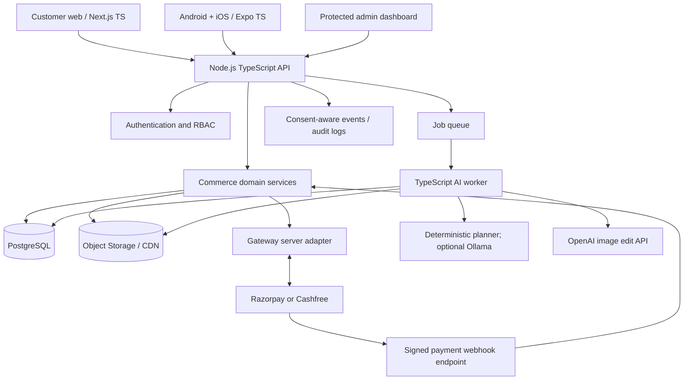
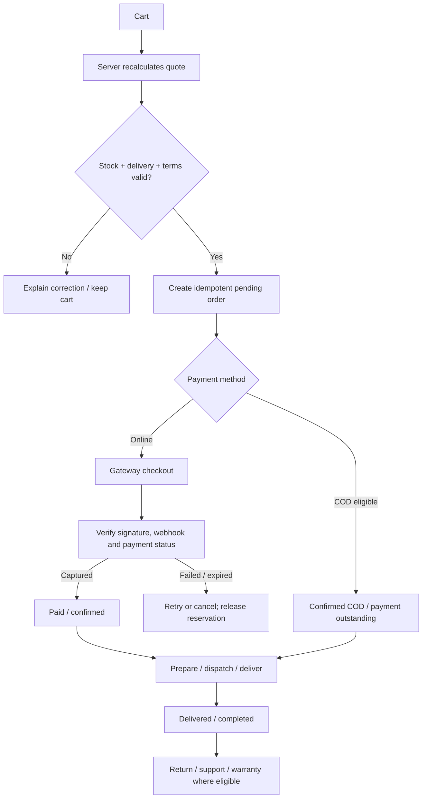
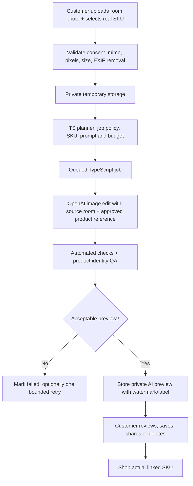

# FORMA FURNITURE - PRODUCTION ROADMAP AND CODEX MASTER WORK ORDER

**Source repository:** https://github.com/latentsig/Forma-furniture  
**Reviewed branch:** `main`  
**Review date:** 2026-10-25  
**Status:** Source-level repository review. Live-site browser behavior, native-device behavior, accessibility, performance, and security penetration tests have not yet been executed. The repository-linked live site was not accessible to the research environment.  
**Mission:** Convert the existing static furniture demonstration into a reliable, responsive, TypeScript-based commerce product with customer and administrator experiences, online payments including RuPay through an approved gateway, optional cash on delivery, order management, later AI room previews, and later Android/iOS applications.

## A. Management verdict and existing-code evidence

The current site is a useful editorial prototype, but it is not a functioning e-commerce platform.

**Verified present:** Seven static HTML pages; HTML/CSS/vanilla JavaScript; 100 catalogue records in four categories (25 Seating, 25 Tables, 25 Bedroom, 25 Storage); client-side filters, search and sorting; three image angles per catalogue item; image zoom controls; demo bag and checkout dialogs; some responsive media queries; 345 image files in `image assets/` (~77 MB of repository image content). README explicitly says checkout does not take payments or store orders.

**Verified gaps and defects:**
1. There are two cart implementations: `script.js` uses an in-memory `bag`, while `pages.js` uses `localStorage` key `forma-demo-bag`. The shopping state is not reliably shared.
2. The homepage Shop link is an anchor, but `script.js` attaches an open-bag handler only when that trigger is a button. Check this regression in browser tests.
3. Checkout submission clears the client-side bag and shows a confirmation dialog without persisting an order, notifying an operator, or collecting payment.
4. Product descriptions are repeated by category: only four different description strings are used for 100 catalogue products. The README says product prices and other product fields are sample content.
5. No TypeScript configuration, frontend framework, backend API, PostgreSQL database, admin system, payment gateway integration, test suite, or CI workflow exists in the source tree.
6. Some mobile header actions use 6px font sizing in `cart.css`, which must be redesigned.
7. Static copy includes business details, marketing claims, default social links, and promotional terms requiring client confirmation before any live launch.
8. The image gallery and keyboard-capable zoom already exist and must be preserved/migrated rather than carelessly recreated.

**Code references:**
- README: https://github.com/latentsig/Forma-furniture/blob/main/README.md
- Homepage cart: https://github.com/latentsig/Forma-furniture/blob/main/script.js
- Catalogue and cart: https://github.com/latentsig/Forma-furniture/blob/main/pages.js
- Catalogue data: https://github.com/latentsig/Forma-furniture/blob/main/catalog-data.js
- Mobile CSS: https://github.com/latentsig/Forma-furniture/blob/main/cart.css

**Assessment:** 5.5/10 for a prototype foundation; 1/10 for production commerce readiness. These are management assessments, not test or visual-usability scores.

### Non-negotiable management direction
- Do not blame a colleague for missing production features that were outside the original demo brief. Criticize the deliverable against the NEW production specification.
- Do not rewrite working visual elements without a regression test and a clear improvement.
- Do not build mobile apps or custom diffusion training before real orders and payments work.
- Do not fabricate product facts, customer reviews, business history, addresses, stock levels, promotions, or AI measurements.
- Do not expose API secrets in frontend code, Expo builds, git, screenshots, logs, or AI prompts.
- Never mark a skipped, failing, or unexecuted test as PASS.

## B. Commercial scope and product tiers

The proposed INR 50,000-80,000 client sale/build price must be treated as a limited-scope starter package, not an all-inclusive quote for a bespoke e-commerce platform, mobile applications, and AI inference product.

**Starter web package (scope to price individually):** branded responsive Next.js storefront, real catalogue and dashboard, managed admin authentication, cart, shipping rules, COD with restrictions, one payment gateway integration, customer order status, basic notification and analytics, domain/hosting handoff, tests. Confirm the actual quote against effort, support, licenses, payment transaction fees, and hosting. Native applications, AI room previews, custom 3D assets, custom model training, advanced returns/ERP integrations, and ongoing maintenance are separate paid stages.

**Enhanced package:** staging/production operations, better logistics, returns/refunds, loyalty, richer analytics, AI room-preview credits, optional mobile apps.

**Advanced package:** true-to-scale AR, design collaboration, advanced recommendations, multi-warehouse/ERP, and custom model research. These require separate feasibility and pricing.

Avoid promising time-to-delivery or a fixed budget without evaluating team capacity, client catalogue quality, gateway merchant verification, deployment access and image generation costs.

## C. Reference patterns to study (do not copy identities)

- IKEA Kreativ: photograph/scan room, remove old furniture, place catalogue products, save/share room designs, distinguish 2D visual preview from spatial 3D scale accuracy.
- Wayfair Decorify: upload room photo, explore generative style ideas, connect results to real purchaseable products.
- India-oriented furniture shopping: pincode delivery, lead times, made-to-order details, COD restrictions, assembly, GST invoice, cancellation, returns, warranties, local payment options.
- Mass-market shopping apps: shareable product URLs, saved collections, recent views, clear order tracking, fast mobile navigation.

Differentiator for Forma: calm premium design, truthful product details and a reliable 'See it in my room' experience linked to actual SKUs. A generated image must never silently replace the product's authentic photograph.

## D. Single recommended stack

- **Language:** strict TypeScript throughout business frontend, backend, workers and React Native app. No Python application/backend.
- **Web:** current supported Next.js + React + TypeScript, server rendering for SEO, responsive PWA, accessible component system, Tailwind CSS.
- **Backend:** Next.js Node-runtime API route handlers with separate service modules and well-defined REST endpoints; central business logic is never duplicated in clients. A standalone NestJS API is optional only if the team and scale justify it.
- **Mobile later:** Expo + React Native + TypeScript on Android and iOS; use Expo development builds for native payment SDKs or deep links.
- **Database:** PostgreSQL, Drizzle ORM, migration files, constraints, transactions and indexes.
- **Auth:** a supported identity provider (e.g. Supabase Auth) with server-validated sessions, email/phone verification, strict admin roles and admin MFA.
- **Media:** private object storage, public product image derivatives through CDN, private room photos by default and signed short-lived URLs.
- **Async jobs:** Node TypeScript worker; add Redis and BullMQ when AI, notification or inventory jobs require queues.
- **Payments:** merchant-verified Razorpay or Cashfree integration, chosen after merchant onboarding and compatibility checks; use hosted checkout/official SDKs.
- **AI:** OpenAI image editing initially, with currently documented `gpt-image-2.5-flare` for cost/speed evaluation and `gpt-image-2.5-sunburst` for quality evaluation. Validate live model access and pricing before enabling it. Planner is deterministic TypeScript; optional local LLM via Ollama only for generating an editable plan/prompt, never for granting permissions or changing business truth.
- **3D AR later:** genuine calibrated GLB/USDZ product assets, `model-viewer` on supported mobile browsers, with fallback to 2D previews; generative image edits do NOT prove physical dimensions or fit.
- **Testing:** Vitest, Playwright, PostgreSQL integration tests, accessibility checks and responsive device checks.
- **Ops:** separate staging/production environments, HTTPS, observability, backups, restore drills, rate limits, alerting and secret storage.

**Important payment rule:** RuPay is a card network, not a TypeScript-specific key. Onboard and use a payment gateway whose account accepts RuPay. OpenAI credentials and payment gateway credentials are unrelated.

## E. Architecture



**Trust boundaries:** External payment events are untrusted until verified. Client totals, stock, discounts, role claims and order states are untrusted until revalidated on the server. User room photos are PRIVATE until the user opts into sharing. Admin approval controls commercial product media.

### Monorepo layout

```text
forma-furniture/
  apps/
    web/                   # Next.js customer + admin + Node API
    mobile/                # Expo React Native, introduced later
    worker/                # Background jobs, introduced when needed
  packages/
    domain/                # Cart, inventory, order, pricing logic
    contracts/             # Typed OpenAPI/Zod contracts and DTOs
    db/                    # Drizzle schema, migrations, seed scripts
    ui/                    # Shared tokens; web-specific React components
    config/                # Validated environment definitions
  docs/
    AUDIT.md
    PRODUCT_REQUIREMENTS.md
    ARCHITECTURE.md
    DATA_MODEL.md
    API_CONTRACT.md
    DESIGN_SYSTEM.md
    AI_EVALUATION.md
    RUNBOOK.md
    QA_REPORT.md
  infra/
    docker-compose.dev.yml
  .github/workflows/
    quality.yml
```

Shared domain and API types are reusable across platforms. Do not assume React DOM components are automatically reusable in native React Native.

## F. Database baseline

Define entities and migrations with correct relations, unique constraints, money stored in integer minor units, timestamps, and a currency code. Do not persist payment card information.

- `users`, `sessions`/external auth links, `user_roles`, `addresses`, `customer_consents`
- `categories`, `products`, `product_variants`, `variant_attributes`, `product_images`, `product_claims`, `product_publish_status`
- `warehouses` if needed, `inventory`, `inventory_reservations`, `inventory_movements`
- `carts`, `cart_items`, `wishlist_items`, `recent_views`
- `delivery_zones`, `shipping_quotes`, `promotions`, `coupons`, `tax_rules`
- `orders`, `order_items` (immutable price snapshots), `order_status_history`, `payment_attempts`, `payment_events`, `refunds`
- `shipments`, `tracking_events`, `returns`, `cancellations`, `customer_support_cases`
- `media_assets`, `ai_jobs`, `ai_job_attempts`, `ai_previews`, `ai_evaluations`, `room_designs`, `share_links`
- `admin_audit_logs`, `notifications`, aggregated/consent-aware `analytics_events`

Mandatory product fields: stable ID/slug, real SKU, title, detailed factual description, price, tax class, category, dimensions, weight, material, color/finish variants, stock/made-to-order mode, realistic lead time, media provenance, shipping/assembly conditions and publication status.

Never trust legacy demo product prices as live prices without client approval.

## G. API surface and customer journeys

Suggested versioned REST endpoints (specify request/response schemas, auth, idempotency, error codes and rate limits):

```text
GET    /api/v1/products
GET    /api/v1/products/:slug
GET    /api/v1/categories
POST   /api/v1/cart/items
PATCH  /api/v1/cart/items/:id
DELETE /api/v1/cart/items/:id
POST   /api/v1/checkout/quote
POST   /api/v1/orders
GET    /api/v1/orders/:id
POST   /api/v1/orders/:id/request-change
POST   /api/v1/orders/:id/cancel
POST   /api/v1/payments/create-session
POST   /api/v1/payments/webhook
POST   /api/v1/ai/room-previews
GET    /api/v1/ai/room-previews/:jobId
POST   /api/v1/shares
GET    /api/v1/shares/:shareId
GET    /api/v1/admin/dashboard
POST   /api/v1/admin/products
PATCH  /api/v1/admin/products/:id
PATCH  /api/v1/admin/orders/:id/status
POST   /api/v1/admin/products/:id/media-approval
```

### Purchase transaction states



### Business rules
- Product availability and quoted payable total are always derived on the server.
- Money in minor units; taxes, coupons and shipping applied exactly once. Confirm appropriate GST and invoicing treatment with the merchant's tax adviser.
- Inventory reservation/commit/release is transactional and safe against concurrent checkout attempts; made-to-order products have explicit lead-time logic.
- Guest checkout is permitted where sensible; users can create accounts later.
- COD is an explicit payment method, not a fake gateway success. Eligible PIN codes, product categories, risk thresholds and optional phone OTP verification are configurable.
- Order modifications before packing/shipping must reprice the order and account for payment difference or refunds. After dispatch, direct editing is disabled and an eligible return/exchange workflow applies.
- Refunds and cancellations require auditable state transitions.
- Payment callbacks and webhooks are signature-verified, deduplicated, and reconciled to gateway status. A browser success callback does not make an order PAID.
- Shareable public product URLs contain no user secrets. User-uploaded room designs are private unless explicitly shared; shared links should be revokeable/expire when appropriate.
- Admin analytics: only collect data with proper notices, consent where applicable, least privilege and a retention policy. Do not expose identities of anonymous visitors.

## H. UI/UX specification

Keep Forma's editorial identity where it works, but give the user ordinary commerce clarity. Product buying must be easier than reading a brand story.

### Customer pages
Home; all products; category landing; searchable/filterable listing; product detail; image gallery; materials/colors/size selector; stock and PIN-code delivery quote; related products; wishlist; cart; shipping/address; checkout; secure gateway return; COD confirmation; order success/failure; order history/details; order modification/cancellation request; account; saved room designs; public share view; help/FAQ; shipping policy; returns/refunds; privacy; terms; contact.

### Admin pages
Dashboard/KPIs; catalog CRUD and bulk import; category/variant editor; asset library with approval; pricing/stock/lead times; customers with privacy-aware access; orders queue and status transitions; payment and COD reconciliation; shipments; cancellations/refunds; promotion rules; AI job queue, quotas and image approvals; web events/funnel; staff RBAC; settings; audit log.

### Design requirements
- Maintain warm neutral visual identity and strong furniture photography, but increase legibility: readable body text, effective contrast, visible focus, minimum practical touch sizes, sticky mobile actions only when not intrusive.
- Product cards need full name, actual price, one or two key features, delivery estimate when known, and clear 'View details' / 'Add to cart' actions.
- Product detail needs dimensions diagram, multiple factual views, material/finish options, price and tax, availability, PIN-code estimate, assembly, warranty, returns information and share button.
- Mobile bottom navigation may include Home, Browse, Saved, Cart, Account; do not put every navigation action in a tiny hamburger list.
- Show loading, zero-result, empty-cart, offline, upload-failed, out-of-stock, payment-pending and error states.
- Use semantic HTML, keyboard/screen-reader support, WCAG 2.2 AA as a design target, avoid layout shifts, and respect reduced-motion preferences.
- Public product/share pages must generate server-rendered Open Graph images and metadata for chat apps, search engines and social shares.
- Ensure data policies and business claims are reviewed before launch.

## I. AI 'see it in my room' architecture and validation

These are three different capabilities and they MUST NOT be conflated:

1. **Gallery:** show authentic photos of the exact SKU from multiple angles (mostly available already).
2. **AI style/room visualization:** upload a customer room photo, select a SKU, generate a labeled visual concept, save and share an approved output. This is NOT a dimensional guarantee.
3. **True-scale AR:** place a verified 3D model of the SKU in the physical room using calibrated measurements and supported device capabilities. This requires 3D assets; it is not achieved by diffusion prompting.

### AI flow



### Planning policy
- Planner is deterministic TS rules for entitlement, user consent, requested product, allowable output types, budget, maximum attempts and fallback behavior. Optional Ollama model can suggest a room styling prompt, but output must pass a schema and must not modify price, identity, permissions, or safety constraints.
- Start by benchmarking OpenAI's current image editing API using supported models. Evaluate speed, cost and preservation across 30 diverse real room photographs and 20 genuine SKU reference sets, with written permission to use samples.
- Use the original product reference, an editable mask/position target if supported, and prompts that explicitly preserve frame shape, proportions, visible materials and hardware. Model adherence is not guaranteed: review actual outputs.
- Require customer control to move, regenerate, compare before/after, choose style, delete photo and opt in before publicly sharing.
- Admin must approve generative marketing images before publishing them as separate lifestyle previews; do not silently overwrite authentic catalogue images.
- Measure job success, product identity match, wrong material/shape rate, image artifact rate, 95th-percentile latency, retry count, and actual API cost per successful preview.
- Enforce per-user quotas, daily organization budget caps, rate limits, file limits, retention/deletion policy, background processing and job cancellation behavior.
- Fail gracefully: if generation fails, keep the ordinary product gallery functional. Never hold checkout hostage to AI.
- If custom diffusion or LoRA is requested, write a separate research feasibility study (dataset rights, training stack, licenses, GPU inference cost, deployment, drift/evaluation). Do not claim all custom diffusion training can be self-hosted in a TypeScript-only runtime without compromises.

## J. PHASED DELIVERY WITH HARD GO/NO-GO GATES

**GLOBAL RULE:** Work on exactly ONE phase at a time. Preserve each phase's evidence in `docs/PHASE_STATUS.md`. On failure: stop, diagnose and repair inside the same phase. Do not begin the next phase or mark anything passed until actual automated and manual checks pass. An unavailable integration test environment is BLOCKED, not PASSED. Each phase produces code, docs, tests and a runnable demo.

### PHASE 0 - Baseline audit, scope lock and clean repository

**Entry:** Current `main` checkout and commit SHA recorded; clean feature branch; current static experience archived without deleting it.

**Implement:**
1. Map every file/page/CSS/JS entry point, component behavior, broken internal link and fake form.
2. Capture desktop/tablet/mobile screenshots and manual navigation flows using Playwright once the repo can be served locally; document mobile issues factually rather than guessing.
3. Inventory 100 sample items and their 300 product gallery references; verify image paths, duplicates, sizes and ownership.
4. Record the two cart implementations, fake checkout, missing system components and template claims.
5. Make a risk register and prioritize the launch-critical subset. Confirm actual merchant/product claims and status of images.
6. Add README setup/instructions and an initial issue/phase checklist, without replacing the existing site.

**Tests:** Serve static site; run link/navigation smoke tests; open representative gallery images; capture responsive screenshots; produce failing tests for known bugs where practical.

**Exit gate:** Signed-off `AUDIT.md`, `PRODUCT_REQUIREMENTS.md`, `ASSET_REGISTER.md` and backlog; baseline test report and explicit pass/block list. Do NOT advance based solely on a textual claim.

### PHASE 1 - Product requirements and responsive design system

**Entry:** Phase 0 passed.

**Implement:**
1. Document customer, guest, administrator, catalogue manager and support roles.
2. Map complete cart-to-payment-to-fulfillment, COD, cancellation, refund and AI preview journeys.
3. Produce wireframes and design specs for customer home, listing, product, cart, checkout, order history, admin dashboard, catalog editor, orders, AI preview.
4. Define responsive breakpoints and design tokens (type scale, spacing, color, states, minimum touch sizes).
5. Audit existing editorial branding. Retain strong photography, remove 6px text, surface prices and buy actions.
6. Define empty/error/loading/success/permission states; real product content checklist.

**Tests:** Review clickable prototypes on 360/390/768/1024/1440 widths, keyboard-only navigation and contrast checks. Perform at least five moderated task walkthroughs if team resources permit.

**Exit gate:** Approved UI specifications, screen inventory, acceptance criteria and named mobile states. NO app code migration until the design/flow contract is stable.

### PHASE 2 - TypeScript migration and functional storefront parity

**Entry:** Phase 1 passed.

**Implement:**
1. Create pnpm monorepo and strict TS config, ESLint, Prettier and CI checks.
2. Implement Next.js routes matching the static pages with no broken image/URL regressions.
3. Replace direct DOM mutation and string-built product HTML with accessible React components.
4. Extract responsive Header, Footer, ProductCard, Gallery, SearchFilterBar, CartDrawer and CheckoutForm.
5. Use a typed temporary catalogue adapter preserving existing 100 demo items; mark all as demo/seed data.
6. Create one unified temporary cart state, versioned schema and persistence strategy; delete the duplicate cart only after regression tests pass.
7. Implement working mobile nav, image carousel/zoom and product share URLs with SSR Open Graph metadata.

**Tests:** `pnpm lint`, `pnpm typecheck`, `pnpm test`, `pnpm build`, Playwright smoke on all seven page equivalents, gallery keyboard navigation and cross-route cart behavior; no horizontal overflow at target breakpoints.

**Exit gate:** Full existing demonstrable feature parity + cleaner mobile UX, zero failed required checks. No server checkout claims yet.

### PHASE 3 - PostgreSQL and validated commerce domain

**Entry:** Phase 2 passed.

**Implement:**
1. Define SQL schema, foreign keys, unique constraints, product variants/SKUs, image metadata and price in integer minor units.
2. Provision local development PostgreSQL with Docker Compose and distinct test database; migrations and transaction-safe seed scripts.
3. Move catalogue from JS arrays to database via a reversible import. Mark demo data as unverified; prevent accidental production publication.
4. Build product/category browse API and robust search, filtering and sorting.
5. Implement a server-side pricing/stock/delivery quote service; protect product writes behind role checks.
6. Build consistent API errors, input validation, idempotency utilities and observability identifiers.

**Tests:** Isolated PostgreSQL integration tests for migration, schema constraints, filter/sort, invalid product, concurrent updates, unpublished product and rollback; real DB connection is required.

**Exit gate:** App reads actual DB catalogue; verified migrations and test DB; fake static catalogue no longer represents production truth.

### PHASE 4 - Authentication, role-based admin and catalogue operations

**Entry:** Phase 3 passed.

**Implement:**
1. Add secure customer sign-in where needed; keep guest browse and guest checkout.
2. Add admin sign-in, MFA and least-privilege roles: OWNER, CATALOG_MANAGER, ORDER_MANAGER, SUPPORT, ANALYST.
3. Implement product CRUD, category/variant/price/availability, image upload/reorder/delete and publication review.
4. Create bulk product CSV import with dry-run validation and actionable errors.
5. Add admin action audit logs and prevent unauthorized customer exports.
6. Implement aggregated visits/conversions with clear notices, retention and permission constraints.

**Tests:** Customer cannot read/write admin endpoints; staff roles cannot exceed grants; image validation, disabled users, stale sessions and CSRF/authorization where applicable; no product edit bypass by HTTP client.

**Exit gate:** An authorized admin can publish a real SKU and customer sees it correctly; forbidden access is reliably denied.

### PHASE 5 - Real cart, delivery quote, checkout and COD

**Entry:** Phase 4 passed.

**Implement:**
1. Build server-validated cart with stable variant IDs, quantity changes, removal and guest/registered merge rules.
2. Implement pincode delivery eligibility, fee/ETA/assembly notes and configurable COD eligibility.
3. Implement checkout address capture, server repricing, consent and order snapshot.
4. Implement inventory reservations/compensation and an idempotent order-create operation.
5. Implement COD with pending payment state, anti-abuse/eligibility settings, optional phone verification, admin approval/confirmation and receipts.
6. Add confirmation communication and real order history with authorization checks.

**Tests:** Price tampering, invalid stock, two concurrent buyers, repeated 'Place order', zero quantity, multiple variants, pincode failure, COD forbidden item, guest checkout persistence, order snapshot.

**Exit gate:** A customer can complete a real COD order saved in PostgreSQL, and an admin can confirm/fulfill it; no duplicate orders on retries.

### PHASE 6 - Online payments, RuPay eligibility, webhooks and refunds

**Entry:** Phase 5 passed; selected merchant gateway account onboarded in sandbox.

**Implement:**
1. Choose one provider (Razorpay or Cashfree) based on actual approved merchant account and enabled RuPay/cards/UPI modes.
2. Store separate test/live credentials only on the server; implement credential validation and rotation guidance.
3. Create gateway order/session server-side using the authoritative payable total and approved order record.
4. Use hosted official checkout for web. Confirm supported SDK approach for future native app.
5. Verify all payment signatures/webhooks over raw request bytes. Store unique event IDs and reconcile duplicates/out-of-order delivery.
6. Confirm capture/settled status before marking order paid, idempotently release stock on genuinely expired/failed payments.
7. Implement retry, pending, failure, success, cancellation and partial/full refund policies with admin audit trail.
8. Never store card number, CVV, OTP or banking passwords.

**Tests:** Gateway sandbox success/failure/pending/refund; tampered signature rejected; duplicated/out-of-order webhook; delayed payment; user closes browser after paying; wrong amount; duplicate order attempts; disabled payment method; COD still works.

**Exit gate:** Real DB and gateway test environments are integrated end to end. Payment success is proven by verified gateway state, not frontend state. No live money movement until approved go-live checkpoint.

### PHASE 7 - Fulfillment, order editing, cancellation and after-sales

**Entry:** Phase 6 passed.

**Implement:**
1. Define `PENDING_PAYMENT`, `CONFIRMED`, `PROCESSING`, `PACKED`, `SHIPPED`, `DELIVERED`, `CANCELLED`, `RETURN_REQUESTED`, `RETURNED`, `REFUND_PENDING`, `REFUNDED` status transitions; keep payment state separate.
2. Implement admin pick/pack/dispatch/tracking, shipment and customer notifications.
3. Allow address/order change requests only in permitted states; recalculate totals and inventory as needed.
4. Implement cancellation/return/exchange eligibility and refund tracking by rules configured with the merchant.
5. Generate legitimate order receipts/invoices with validated tax/business data and downloadable admin/customer views.
6. Add customer support cases and admin notes with audit.

**Tests:** Forbidden status jumps, cancellation after dispatch, partial refund, restocking, failed shipment, duplicated notifications, reconciliation between orders/payments/shipments.

**Exit gate:** End-to-end operational flow from purchase through delivery and after-sales can be audited from database records.

### PHASE 8 - Admin AI product-content pilot (controlled cost)

**Entry:** Phases 3, 4 and 6 stable; true product reference photography legally available.

**Implement:**
1. Admin uploads approved SKU product images and requests alternate lifestyle scenes; existing authentic product images remain canonical.
2. Deterministic TypeScript planner validates SKU identity, allowed tasks, aspect ratio, privacy, prompt, cost quota and approval requirements.
3. Async worker invokes supported OpenAI image edits, with stable job IDs, timeout/retry/cancellation handling, cost/latency metrics.
4. Store generated images separately as AI previews with provenance, original sources, prompt version, model name and human approval status.
5. Build admin comparison, reject, retry, approve and publish-preview controls.

**Tests:** Mock model timeout/invalid response, wrong-SKU guard, cost cap, failure isolation, no accidental auto-publish, audit trail, approved image retention/deletion.

**Exit gate:** Admin can publish a specifically labeled AI lifestyle preview without mutating the real SKU photo or breaking commerce.

### PHASE 9 - Customer AI room upload, preview and sharing

**Entry:** Phase 8 passed; user upload privacy and retention review approved.

**Implement:**
1. Upload photo/camera from web and mobile browser with explicit consent, private storage and EXIF removal.
2. Choose a real SKU, optional style and target placement region; generate a labeled room concept through the same AI worker.
3. Provide before/after, variations, save/remove, regenerate within quota, share-on-opt-in, and shop exact linked SKU.
4. Add shareable preview links with revoke and expiry controls; do not reveal private room images through a public product URL.
5. Offer AI preview deletion and data retention controls.
6. Run image-faithfulness evaluation with a documented dataset and cost/latency report; do not claim accurate fit/scale.

**Tests:** Consent denied, private URL access denied, oversize or unsafe upload, multi-device use, share revoke, quota, duplicate request, cost budget, image QA, model outage fallback.

**Exit gate:** Room preview is honest, privacy-preserving and reliable enough to demonstrate; checkout works even if AI is offline.

### PHASE 10 - Android and iOS native app

**Entry:** Web/API checkout and order flows passed production-like staging tests.

**Implement:**
1. Build Expo TypeScript app for Android and iOS with Home, Browse, Product, Saved, Cart, Checkout, Orders, Account and Room Preview.
2. Reuse typed domain contracts and server APIs, NOT copy web DOM components into native code.
3. Implement camera/photo selection, push notifications, deep links and share actions.
4. Use official gateway-supported React Native/hosted checkout compatible with native App Store and Play Store policies for physical goods.
5. Configure deep-link association, privacy manifest/permissions, signing and release management via Expo development builds and EAS.
6. Prepare QA builds, store listing screenshots/descriptions and support/privacy pages.

**Tests:** Physical Android Pixel, at least one additional Android brand, iPhone, iPad; realistic low-network/offline cases; payment return from external app; deep link, accessibility, native back button, share, file permissions.

**Exit gate:** Real device smoke suite and signed Android/iOS candidate builds pass. Store approval is a separate external gate.

### PHASE 11 - Hardening, growth analytics and reliability

**Entry:** Core customer and admin journeys implemented.

**Implement:**
1. Add server-side security review: RBAC, injection defenses, rate limiting, CSRF as applicable, strict input/media validation, SSRF protections for remote URLs, secret scanning, dependency auditing and PII minimization.
2. Validate mobile Core Web Vitals (LCP <= 2.5 sec, INP <= 200 ms, CLS <= 0.1 at the 75th percentile where field data exists).
3. Add WCAG 2.2 AA review, 200% zoom, keyboard, screen reader, contrast, language and reduced motion coverage.
4. Implement useful funnel analytics (product_view -> add_to_cart -> checkout_start -> payment_attempt -> purchase) with consent-aware collection and no raw payment secrets.
5. Add alerts, request IDs, structured logging, audit retention and data backup/restore drills.
6. Validate SEO: SSR product pages, canonical URLs, schema.org/Product/Offer truthfulness, image alt, sitemap and robots policy.

**Tests:** Load tests, automated scans, manual device matrix, expired sessions, image abuse attempts, disaster recovery restore rehearsal.

**Exit gate:** No critical/high unresolved security bugs; measurable performance/accessibility metrics and traceable evidence.

### PHASE 12 - Controlled production launch and client handover

**Entry:** All required launch phases passed and merchant approves domain, gateway account, policy copy, inventory and support process.

**Implement:**
1. Separate staging and production DB, buckets, OAuth keys, gateway test/live credentials and webhooks.
2. Provision HTTPS domain, backups, monitoring, on-call ownership and deployment/rollback runbook.
3. Reconcile physical inventory and product facts; verify policies for shipping, returns, privacy, terms, contact, tax and complaint support.
4. Start with small live pilot. Verify 1 genuine approved low-risk payment and 1 COD order, refund path, webhook handling, inventory, invoices and delivery notifications under authorized merchant control.
5. Complete analytics and finance reconciliation, error monitoring and product feedback.
6. Handover architecture, env-variable inventory without secrets, admin training, support workflows, uptime obligations and an itemized scope of excluded enhancements.

**Tests:** Automated smoke in production without destructive transactions; approved live payment smoke; staged rollback; backup restore; no regression.

**Exit gate:** Client signoff on tested functionality and operating responsibilities. Explicitly document anything deferred as future roadmap, not as shipped.

## K. Status reporting and exact definition of done

For every phase provide a report in this precise form:

```markdown
## Phase N - [Name]
Status: PASS | FAIL | BLOCKED
Branch / commit:
Scope implemented:
Files changed:
Database migrations and rollback:
UI screenshots / video evidence:
Commands executed and summarized output:
Unit tests: total / passed / failed / skipped
Integration tests: total / passed / failed / skipped
E2E tests: total / passed / failed / skipped
Responsive / accessibility checks:
Security / privacy review:
Known unresolved issues:
Documentation updated:
Go / No-Go decision:
Next phase allowed: YES | NO
```

**Do not treat missing `DATABASE_URL`, absent webhook credentials, no real device, skipped suites, a mocked payment, or an unavailable OpenAI image model as a successful test.** If a phase requires that environment, mark BLOCKED and state exactly what secret/resource an authorized operator must configure. Never print or request that a user paste secrets into chat.

## L. The single ready-to-paste Codex execution prompt

You are the principal engineer, strict QA lead, security reviewer and product designer responsible for upgrading `https://github.com/latentsig/Forma-furniture`.

Read this complete specification before changing code. Your mandatory mission is to preserve the existing brand's useful static work while converting it into a trustworthy production-capable furniture commerce application. Frontend, backend, workers, API contracts and mobile application code must be TypeScript, except normal declarative configuration, SQL and platform-native generated build files. Do not use Python as the application/backend language. Model API keys are service credentials, not tied to a programming language. Use a supported India payment gateway for RuPay and COD as a separate server-owned order path.

**Rules:**
1. Do Phase 0 only on the first execution. Do not implement multiple phases at once. Inspect the actual git tree and current code; never invent implementation evidence.
2. Preserve existing imagery/brand and working catalogue/gallery/zoom until replacement tests pass. Do not delete old files blindly.
3. Create a branch and initial documentation, determine current baseline, implement tests to capture known defects, then report what is VERIFIED vs PROPOSED.
4. Create `docs/PHASE_STATUS.md`; record every phase test command, result and any skipped tests. A skipped or unavailable required test means BLOCKED or FAIL, never PASS.
5. Security, privacy and trust are non-negotiable: no secrets in git or client bundles; no fake payment/order confirmation; verify gateway signatures/webhooks; server authorizes all prices, stock, roles and order state; private room uploads; consent-based sharing.
6. Use staged implementation and approval: Phase 0 baseline; Phase 1 design; Phase 2 Next.js TS migration; Phase 3 PostgreSQL domain; Phase 4 auth/admin; Phase 5 cart/COD; Phase 6 payment gateway/RuPay; Phase 7 fulfillment; Phase 8 admin AI preview; Phase 9 customer room preview; Phase 10 Expo Android/iOS; Phase 11 hardening; Phase 12 launch.
7. Do not train custom diffusion models or start Expo before the commerce platform passes its gates. First benchmark managed image editing against real SKU images and room photographs. Honest visualization is not real scale-accurate AR.
8. Tests must execute against isolated test systems. For database tests, create/require a separate test database and migrate it. Never run destructive integration tests against production data.
9. For each phase produce the required artifacts, complete the tests, give a concise owner-ready acceptance report, and stop. Wait for explicit approval to begin the next phase.

**Start now with Phase 0:** audit the repository, verify all code claims in section A, inventory assets, document all customer journeys and known defects, capture a responsive test baseline, produce `docs/AUDIT.md`, `docs/PRODUCT_REQUIREMENTS.md`, `docs/ASSET_REGISTER.md`, and `docs/PHASE_STATUS.md`. Report PASS/FAIL/BLOCKED with raw test totals and actual evidence. Do not implement Phase 1 yet.

---

## M. Authoritative references checked on 2026-10-25

- IKEA Kreativ India: https://www.ikea.com/in/en/customer-service/knowledge/articles/ec8c6ace-ef3d-428c-be25-fdb1e6fa75be.html
- Wayfair Decorify launch: https://investor.wayfair.com/news/news-details/2023/Wayfair-Launches-Decorify-a-Virtual-Room-Styler-Powered-by-Generative-AI/default.aspx
- OpenAI image edit API: https://developers.openai.com/api/docs/guides/image-generation
- Cashfree web checkout: https://www.cashfree.com/devstudio/preview/pg/web/checkout
- Razorpay security checklist: https://razorpay.com/security/checklist
- Expo docs: https://docs.expo.dev/
- Expo development builds: https://docs.expo.dev/develop/development-builds/faq/
- Apple physical goods payments: https://developer.apple.com/app-store/review/guidelines/
- Google Play physical goods policy: https://support.google.com/googleplay/android-developer/answer/9858738
- 3D AR viewer: https://modelviewer.dev/docs/index.html
- Google Core Web Vitals: https://developers.google.com/search/docs/appearance/core-web-vitals
- WCAG 2.2: https://www.w3.org/TR/wcag/
